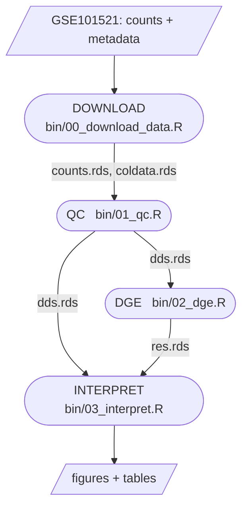

# Bulk RNA-seq in R, orchestrated with Nextflow — MDD vs control

A small, fully-built Nextflow pipeline that runs a bulk RNA-seq case–control analysis
**in R**, from a counts matrix through QC, differential expression, and interpretation.
Dataset: postmortem dorsolateral PFC, major depressive disorder vs non-psychiatric
controls (Pantazatos et al., *Mol Psychiatry* 2017,
[GSE101521](https://www.ncbi.nlm.nih.gov/geo/query/acc.cgi?acc=GSE101521), PMID 27528462).

## How it's organised
Each pipeline step is a Nextflow process that wraps **one R script** in `bin/`:

```
main.nf                 the pipeline: DOWNLOAD -> QC -> DGE -> INTERPRET
nextflow.config         params + local executor
bin/
  00_download_data.R    download counts, build sample sheet (29 CON vs 30 MDD)
  01_qc.R               filter, VST, PCA, sample-distance heatmap, drop outlier
  02_dge.R              DESeq2 (~condition and ~sex+condition), shrinkage, plots
  03_interpret.R        volcano, top-gene heatmap, GO enrichment
```
Nextflow puts `bin/` on the PATH, so each process just calls its script. Outputs are
published to `results/{data,figures,tables}`.

## Run
```
nextflow run main.nf              # run the whole pipeline
nextflow run main.nf -resume      # re-run; unchanged steps are cached
```
Open in GitHub Codespaces — the dev container installs R + Bioconductor packages,
Java, and Nextflow on first build.

## Pipeline diagram
The diagram below renders automatically in GitHub's Markdown preview (in Codespaces:
open `README.md`, then the preview button) — nothing to install.

To regenerate it straight from the pipeline (no manual drawing):
```
nextflow run main.nf -preview -with-dag dag.html   # -preview = build the DAG without running; open the HTML in a browser
```
A cleaned, labelled version lives in `docs/pipeline.mmd`:


## Sessions (demo-based, no slides)
One step per session: read the R script, explain the methodology around it, run it inside
the pipeline (`-resume`), and inspect the published outputs.

1. **DOWNLOAD** — counts matrix into R, sample sheet, factors
2. **QC** — library sizes, filtering, normalization (VST), PCA, outlier handling
3. **DGE** — design, DESeq2, shrinkage, reading results; covariate model (`~ sex + condition`)
4. **INTERPRET** — volcano, heatmap, GO enrichment, the biology

## Where this sits in a full RNA-seq workflow
This pipeline starts at the counts matrix. The upstream half (FASTQ → trim → align/quant →
counts) is what a pipeline like `nf-core/rnaseq` produces; GEO's counts are that output.
We pick up exactly there and focus on the analysis in R.
